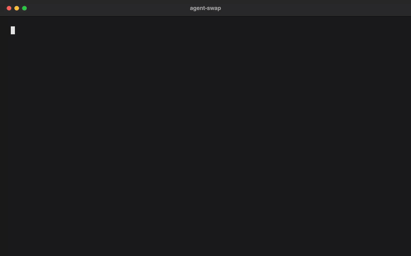
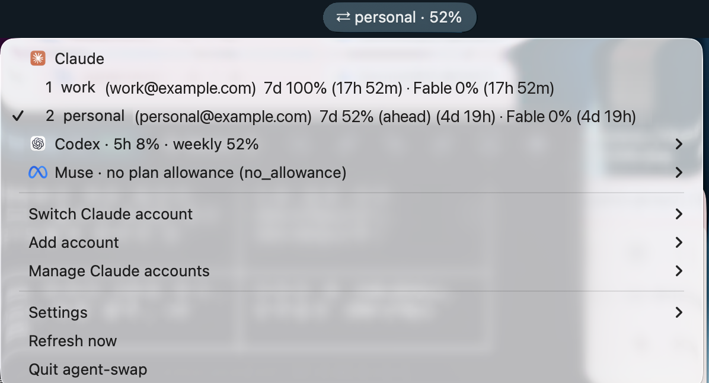

<p align="center">
  
</p>

<h1 align="center">agent-swap</h1>

<p align="center">
  <strong>Switch Claude Code accounts without logging out — and see Codex and Muse usage in the same place.</strong>
</p>

<p align="center">
  <a href="https://github.com/woorichicken/agent-swap/actions/workflows/ci.yml"></a>
  <a href="LICENSE"></a>
  <a href="#requirements"></a>
</p>

<p align="center">
  <a href="https://agent-swap.solhun.com">Website</a> ·
  <a href="#quick-start">Quick start</a> ·
  <a href="#menu-bar-macos">Menu bar</a> ·
  <a href="https://github.com/woorichicken/agent-swap/issues">Report a bug</a>
</p>

<p align="center">
  
</p>

## Highlights

- **Switch without logging out.** Keep several Claude accounts and move between them from the Claude Code CLI or the VS Code extension.
- **Switch before the limit.** `cswap auto` moves to another account before you hit a rate limit.
- **Every limit in one place.** A live dashboard tracks usage for every account, and `aswap list` adds Codex and Muse.
- **Run accounts in parallel.** Session mode keeps more than one account going at the same time.
- **A macOS menu bar.** Usage at a glance, with a click to switch.

## Quick start

```bash
uv tool install git+https://github.com/woorichicken/agent-swap

# Log into Claude Code with your first account, then save it
cswap add

# Log in with another account (do not /logout first), save it too
cswap add

# Every account's 5-hour / 7-day usage, plus Codex and Muse
aswap list

# Switch, or let it switch for you before the limit
cswap switch
cswap auto --threshold 80
```

## Contents

- [What's different from claude-swap](#whats-different-from-claude-swap)
- [Installation](#installation)
- [Usage](#usage)
- [Tips](#tips)
- [How it works](#how-it-works)
- [Data locations](#data-locations)
- [Menu bar (macOS)](#menu-bar-macos)
- [Advanced](#advanced)
- [Uninstall](#uninstall)
- [Requirements](#requirements)
- [Contributing](#contributing)
- [License](#license)

## What's different from claude-swap

An MIT fork of [claude-swap](https://github.com/realiti4/claude-swap). It keeps your
existing Claude accounts, data, and the `cswap` command, and adds:

- `aswap` / `agent-swap` commands.
- Read-only Codex and Muse usage in `aswap list` and the menu bar (Codex 5h /
  weekly / credits; Muse today's requests, tokens, and estimated cost from local
  session logs).
- A menu bar grouped by agent: Claude accounts, then one row per agent with a
  submenu (usage page, sign in / change account in Terminal, status). "Add
  account" covers Claude, Codex, and Muse; Settings → Agents in menu hides rows.

Codex and Muse keep one login each — agent-swap reads their usage but never
switches their accounts.

## Installation

### Using uv (recommended)

When replacing an existing `claude-swap` uv tool, run
`uv tool uninstall claude-swap` first to release its `cswap` / `claude-swap`
commands and prevent a later upstream upgrade from replacing them. This removes
the tool installation only; existing accounts and data stay in place.

```bash
uv tool install git+https://github.com/woorichicken/agent-swap
```

### Using pipx

```bash
pipx install git+https://github.com/woorichicken/agent-swap
```

### From source

```bash
git clone https://github.com/woorichicken/agent-swap.git
cd agent-swap
uv sync
uv run cswap help
```

### Updating

```bash
aswap upgrade          # reinstalls this fork with uv; cswap upgrade is an alias
# or run the same installer command directly:
uv tool install --force git+https://github.com/woorichicken/agent-swap
```

The forced reinstall uses the base package. If you use the optional menubar
extra or custom installer options, reapply those with your install command.

## Usage

### Add your first account

Log into Claude Code with your first account, then:

```bash
cswap add
```

### Add more accounts

Log in with another account, then:

```bash
cswap add
```

Do not run `/logout` first: current Claude Code may revoke the refresh token stored for the account you are leaving.

### Switch accounts

Rotate to the next account:

```bash
cswap switch
```

Or switch to a specific account:

```bash
cswap switch 2
cswap switch user@example.com
cswap switch dev                # or by alias, once set with `cswap alias 2 dev`
```

Not sure which one? `cswap list` is the dashboard — every account's 5-hour and 7-day usage and reset times at a glance:

```bash
cswap list
```

The list ends with **Other agents:**, showing the signed-in Codex account's
5-hour / weekly usage and credits, plus Muse's subscription allowance and today's local usage. A failed
query displays `unavailable (reason)` rather than 0%; Muse is omitted when not installed.
Each query times out after 10 seconds and cleans up its child process group.
These queries only read usage; they never switch Codex or Muse accounts.

`aswap list --json` adds an `otherAgents` object keyed by `codex` and, when
installed, `muse`. Codex includes `primary` / `secondary` (`usedPercent` and
`resetsAt` in Unix seconds), `credits`, and `planType`; Muse includes `allowance`
and `reason`. Both carry `status` (`ok` or `unavailable`); failures include a
`reason`. Set `ASWAP_CODEX_BIN` or `ASWAP_MUSE_BIN` to override the executable.

Or let claude-swap auto-pick by remaining quota — `cswap switch --strategy best` (most quota left) or `--strategy next-available` (skip rate-limited accounts).

**Note:** You usually don't need to restart — on Linux/Windows the new account is picked up automatically, and on macOS after the Keychain cache expires. To apply it instantly, restart Claude Code or reopen the VS Code extension tab. See [Tips](#tips) for the per-platform details.

### Automatic switching

Let claude-swap watch your usage and switch for you. When the active account's 5-hour or 7-day window reaches the threshold (default 90%), it switches to the account with the most quota left — before you hit the limit, and safe to run while Claude Code is working:

```bash
cswap auto                     # foreground loop, polls every 60s
cswap auto --threshold 80      # switch earlier
cswap auto --weekly-threshold 97   # let the weekly window run higher before switching
cswap auto --model Fable       # also switch when the Fable weekly limit is hit
cswap auto --once              # single check-and-switch, for cron/scripts
cswap auto --dry-run           # log what it would do, never switch
cswap auto --strategy weekly-first    # switch at the threshold, onto the soonest weekly reset
cswap auto --strategy consume-first   # burn the soonest-resetting account first
cswap auto --strategy priority-consume-first   # your own tiers first, then soonest weekly reset
```

<details>
<summary>How it behaves & advanced usage</summary>

- Runs safely alongside Claude Code: switches take the same credential locks Claude Code uses, so a swap never collides with a token refresh.
- A cooldown (default 5 min) and a hysteresis margin stop it flip-flopping near the threshold: a proactive switch only lands on an account that's below the threshold *and* better than the current one by the margin — a candidate that clears the margin is always taken, but two accounts hovering at the line never ping-pong. When every account is already over its switch lines, it moves to the one with the most quota left before a limit (the lowest usage on its fullest window, whatever line that window carries) whatever the strategy, once that account has twice the current one's remaining quota or 3 points more than it, whichever is less. When every account is exhausted it keeps checking on a bounded slow cadence, waking sooner for an imminent reset.
- **Strategies** (`--strategy`, or `cswap config set autoswitch.strategy`): `best` (default) stays put until the active account nears its limit, then moves to the account with the most quota left. `weekly-first` switches at the same lines as `best`, with the same landing rules and hysteresis margin, but among the accounts that qualify it lands on the one whose **weekly window resets soonest** (most quota left breaks ties), so weekly quota that would otherwise expire unused gets spent first; its at-limit and failover escapes, and the all-over-the-lines case, rank by quota left exactly as `best` does. `consume-first` proactively keeps you on the account whose **weekly window resets soonest** — use-it-or-lose-it — switching to a sooner-resetting account (with room to spare) even below the threshold, so perishable weekly quota isn't wasted. `priority-consume-first` follows your own ranking first (see *Account priority tiers* below), then the soonest weekly reset within a tier.
- **A separate line for the weekly windows** (`--weekly-threshold 97`, or `cswap config set autoswitch.weeklyThreshold 97`): one threshold compared against the busiest window forces the same number on windows that want different ones — the 5-hour window recycles in hours (an overshoot costs one interrupted turn), while the weekly window is the budget (quota unspent before its reset is gone). With a weekly line, the 7-day window and any per-model window (`--model`) are judged against it and the threshold keeps governing the 5-hour window; every window is compared against its own line, so 7d 93% under a 97 line holds while 5h 95% under an 85 line switches, and the log names the window it measured (`7d 93% < 97%`). Points on different windows are not the same amount of work — the lines are comparable, the clocks are not.
- Usage polling is adaptive — a couple of accounts per check, busy alternates watched more closely, and exhausted ones checked about every ten minutes (or slower after 429s) — so API traffic stays flat no matter how many accounts you manage.
- It fails safe: if a usage check errors it keeps trusting the last-known numbers while retries back off, and an expired token on an idle machine makes it hold rather than fail over (Claude Code refreshes the token on your next message).
- An account whose refresh token has died is quarantined and reported until you either log in with it and re-run `cswap add --slot N`, or replace its stored credentials from a known-good export — a plain `cswap import backup.cswap` replaces dead-token slots on its own (`--force` is still required to replace other existing accounts; note a stale export can carry an already-superseded token). API-key accounts are never rotated onto unless you pass `--include-api-key-accounts`.
- To hold an account out of rotation yourself — a work account you don't want touched, one you're resting — run `cswap disable <num|email>`; `cswap enable <num|email>` puts it back. Disabled accounts are skipped by auto-switch, bare `cswap switch`, and the `best` / `next-available` strategies, but stay fully managed and remain a valid explicit `cswap switch <num|email>` target. They show a `(disabled)` marker in `cswap list`, in the [TUI](#interactive-dashboard-tui), and in the [menu bar](#menu-bar-macos) — both of which also let you toggle the state in place (TUI: menu → *Disable / enable account…*; menu bar: *Disable / enable account*).
- **Per-account threshold.** `cswap threshold <num|email> <pct>` gives one account its own switch-away line (50–99.9) in place of the global one: auto-switch leaves that account when *its* line is reached and prefers candidates still under *theirs*, with ranking and the hysteresis margin counting room under each account's own line rather than raw headroom. Like the global threshold it is a switch-away line, not a hard cap — with nothing under its line, or the active account at its limit, it still lands somewhere rather than stall (`priority-consume-first` is the exception: it holds, see below). With a weekly line set, the override applies to the 5-hour window only. Accounts without one keep the global threshold. `cswap threshold` alone lists the default and every override, `--unset` clears one, and the [TUI](#interactive-dashboard-tui) shows a `th 85%` badge.
- **Account priority tiers.** `cswap priority <num|email> <tier>` ranks an account for the `priority-consume-first` strategy: higher tiers are used first, accounts without one are tier 0 (valid tiers are 0–1000), and within a tier the account whose weekly window resets soonest goes first. It moves back to a higher tier as soon as that account is usable again (after the cooldown), and it never lands on an account at or over its switch lines — when nothing qualifies, even at the limit, it holds and keeps polling instead of relaxing them. Tiers alone change nothing; `best`, `weekly-first`, `consume-first`, and manual switching ignore them. It uses neither the hysteresis margin nor the exhausted slow cadence described above: equal tiers and reset times keep the active account, and a blocked state keeps polling at the normal interval. `cswap priority` lists every account's tier and `--unset` clears one.
- By default only the account-wide 5h/7d windows drive switching. If you work on one model and hit its **weekly per-model limit** first (e.g. Fable), add `--model Fable` (or `cswap config set autoswitch.model Fable`) to fold that model's window into the decision, so it switches off an account whose model quota is spent even while its 5h/7d windows still have room.
  - **Model names** are Anthropic's own per-model `display_name`s, matched case-insensitively. The exact strings for your accounts are the per-model rows in `cswap list` (e.g. a line reading `Fable: 100%`).

For cron/systemd timers, `--once` reports the outcome in its exit code (`0` switched, `1` error, `2` nothing to do, `3` blocked — no viable target), and `--json` emits one JSON event per line:

```bash
*/5 * * * * cswap auto --once --json >> ~/.cswap-auto.log 2>&1
```

Defaults like the threshold and cooldown are configurable with `cswap config set autoswitch.threshold 80` — flags override them (see [Configuration](#configuration)).

</details>

### Run multiple accounts at the same time (session mode)

Launch Claude Code as a specific account in the current terminal only — every other terminal and the VS Code extension stay on your default account, so two accounts can work in parallel.

```bash
cswap run 2                     # launch Claude Code as account 2, here only
cswap run user@example.com      # by email
cswap run 2 -- --resume         # everything after '--' is forwarded to claude
cswap run 2 --share-history     # share your chat history with this account too
cswap run 2 --require-session   # refuse rather than run plain claude if 2 is the default login
```

Sessions use your normal `~/.claude` setup (settings, CLAUDE.md, skills, MCP servers, etc.), but each account keeps its own chat history — pass `--share-history` if you want your accounts to continue the same conversations, or make it the default for every `cswap run` with `cswap config set run.shareHistory true` (`--no-share-history` still opts out per launch; on Windows the setting is ignored with a warning, while an explicit `--share-history` errors).

Running the account that is already your default login launches plain `claude` on that login instead of a session (a second copy of the active credential would go stale). Scripts that need the isolation guaranteed can pass `--require-session`, which refuses in that case instead.
  
A session refreshes its own copy of the account's token, so once it exits, the credential it rotated is captured back into the account's stored backup before a switch or usage check uses that backup. While a session is still running, `cswap switch` refuses to move the default login onto its account if the stored backup has already fallen behind (activating it could only fail); exit the session first, or pick another account. While a session runs, its account's usage is read with the session's own credential and never refreshed by cswap; a read the server refuses shows as token expired, and is not requested again, until the session renews the credential on its next call.

<details>
<summary>Sharing details — MCP servers & chat history</summary>

- With `--share-history`, a session started under one account shows up in `--resume` under the others, and nothing already saved is lost.
- User-scope MCP servers (`claude mcp add -s user`) are mirrored from your default profile on every launch — manage them there; changes made inside a session don't persist. Definitions are copied as-is (including inline `env`/`headers` values), but MCP OAuth logins are not — HTTP servers may ask you to authenticate once per profile via `/mcp`.
- `--no-share` turns sharing off and removes the mirrored MCP config (profiles that never mirrored are left alone).

</details>

<details>
<summary>Map accounts to directories — auto-pick per repo</summary>

Bind a directory to an account, and a bare `cswap run` there launches that account in session mode — e.g. work account in work repos, personal elsewhere:

```bash
cswap map 2 ~/work/client-app   # map a directory to account 2
cswap map user@example.com      # map the current directory
cswap map                       # list mappings
cswap unmap ~/work/client-app   # remove one (defaults to current directory)

cd ~/work/client-app/src
cswap run                       # → account 2, session mode
```

Subfolders inherit the nearest mapped ancestor. In an unmapped directory, `cswap run` just launches plain `claude` with your default login. Mappings are per-machine (not part of `cswap export`) and are cleaned up when their account is removed.

</details>

### Interactive dashboard (TUI)

Run `cswap` on its own (or `cswap tui`) for the full-screen dashboard: live usage for every account, switching, and the auto-switcher, all keyboard-driven. `cswap watch` opens it straight to the live monitor. Works on macOS, Linux, and Windows.


### Refresh expired tokens

If an account's token expires, log back into Claude Code with that account and re-run:

```bash
cswap add
```

This will update the stored credentials without creating a duplicate.

### Other commands

```bash
cswap run 2                     # Run an account in this terminal only (session mode)
cswap auto                      # Auto-switch when nearing rate limits (see above)
cswap config                    # Show or edit settings (see Configuration below)
cswap list                      # Show all accounts with 5h/7d usage and reset times
cswap list --token-status       # Add source-labelled OAuth token diagnostics
cswap status                    # Show current account
cswap add --slot 3              # Add account to a specific slot (prompts before overwrite)
cswap add --alias dev           # Add account and give it a short alias
cswap remove 2                  # Remove an account
cswap disable 2                 # Hold an account out of auto-rotation (keeps its login)
cswap enable 2                  # Return a disabled account to rotation
cswap threshold 2 85            # Switch away from account 2 at 85%, not the global default
cswap threshold 2 --unset       # Return account 2 to the global default
cswap threshold                 # Show the global default and every per-account override
cswap priority 2 100            # Use account 2 before lower tiers (priority-consume-first strategy)
cswap priority 2 --unset        # Return account 2 to tier 0
cswap priority                  # Show every account's tier
cswap alias 2 dev               # Give an account a short alias (usable anywhere NUM|EMAIL is)
cswap alias 2 --unset           # Remove an account's alias
cswap alias                     # List all aliases
cswap move 2 1                  # Assign an account to a slot (relocates to an empty slot, swaps if taken)
cswap unclaimed                 # List stashed credential entries (slot + why they were stashed)
cswap unclaimed --purge ID      # Drop one (deletes its bytes; recover with /login + `cswap add`)
cswap tui                       # Interactive dashboard (also: bare `cswap`)
cswap watch                     # Dashboard, opened on the live watch page
cswap upgrade                   # Reinstall agent-swap from the fork repository
cswap purge                     # Remove all claude-swap data
```

The original flag spellings (`cswap --switch`, `cswap --list`, ...) keep working.

## Tips

- **Do you need to restart after switching?** Usually not. On **Linux and Windows**, credentials are stored in a file and Claude Code re-reads them whenever that file changes, so the new account takes effect on your next message — no restart needed. On **macOS**, credentials live in the Keychain, which Claude Code caches for about 30 seconds; a running session picks up the switch once that cache expires. Restart Claude Code (or close and reopen the VS Code extension tab) only if you want the change to apply instantly.
- **Continuing sessions after switching:** You can keep using the same Claude Code session after switching — run `cswap switch` in any terminal and carry on. If you'd prefer a clean start, close and reopen Claude Code (or the VS Code extension tab) and use `--resume` to pick your previous session. Either way, the first message on the new account may use extra usage as its conversation cache rebuilds.

## How it works

- Backs up OAuth tokens and config when you add an account
- Swaps only the account-specific Claude login when you switch accounts;
  live account-independent OAuth state (such as MCP server logins) is
  preserved instead of being overwritten by a slot's older snapshot
- Account credentials stored securely using platform-appropriate methods
- Switches (manual and automatic) hold Claude Code's own credential locks while writing, so a swap never interleaves with a token refresh
- Auto-switch freshens a target's token before activating it, and quarantines accounts whose refresh token has died (recover by re-adding it with `cswap add --slot N`, or by replacing its stored credentials from a known-good export — a plain `cswap import backup.cswap` replaces dead-token slots automatically)
- Usage numbers refresh every few minutes — faster for an account being used or close to switching, slower for idle ones — keeping cswap comfortably inside Anthropic's rate limits however many dashboards you keep open on a machine. An age note like `· 6m ago` just means the next scheduled check hasn't come yet, not that something is stuck.

## Data locations

| Platform | Credentials | Config backups |
|----------|-------------|----------------|
| Windows | File-based (inside the backup directory, under `credentials/`) | `~/.claude-swap-backup/` |
| macOS | macOS Keychain | `~/.claude-swap-backup/` |
| Linux / WSL | File-based (inside the backup directory, under `credentials/`) | `${XDG_DATA_HOME:-~/.local/share}/claude-swap/` |

Session-mode profiles (`cswap run`) live under the backup directory in `sessions/`. Tool preferences (`settings.json`) and auto-switch state (`autoswitch_state.json` — cooldown and quarantined accounts; delete it to reset) live in the backup directory root.

On Linux/WSL, set `XDG_DATA_HOME` to override the default location.

## Menu bar (macOS)

<p align="center">
  
</p>

<details>
<summary>Optional macOS menu bar app — usage at a glance, click to switch</summary>

Needs the `menubar` extra (macOS only):

```bash
uv tool install 'agent-swap[menubar] @ git+https://github.com/woorichicken/agent-swap'
cswap menubar
```

Shows every account's 5h / 7d / spend usage and switches with a click (specific / rotate / best / next-available), plus the TUI's add / disable-enable / remove / refresh actions. Enable *Settings → Auto-switch accounts* to run the same engine as [`cswap auto`](#automatic-switching) in the background; it shares the `autoswitch.*` settings, so the menu bar and CLI stay in sync. Off until you turn it on.

The icon is owned by a small wrapper bundle, `/Applications/claude-swap Menubar.app`, that `cswap menubar` builds (and refreshes after upgrades) on every start before hopping into it. That gives the process the bundle identifier `com.claude-swap.menubar`, which is what menu bar managers (Dimble, Ice, Bartender, SaneBar) key on to list, hide and order an icon; a bare Python process has none and is invisible to them. It has to be `/Applications`: macOS resolves a status item's owner from the app's location, and for an app anywhere else the item's identity is nil, so the first time a manager hides anything the icon goes down with it. If `/Applications` is not writable the bundle lands in the data directory and you get a one-line warning. Set `CLAUDE_SWAP_NO_BUNDLE=1` to run in the plain interpreter instead.

**Keep it running without a terminal.** `cswap menubar` runs in the foreground, so the status item dies with the terminal that started it and does not come back after a reboot. `--install-service` hands it to launchd instead — starts at login, restarts on crash:

```bash
cswap menubar --install-service     # start now, and at every login
cswap menubar --service-status      # installed? loaded? pid?
cswap menubar --uninstall-service   # stop it and remove the plist
```

The agent lives at `~/Library/LaunchAgents/com.cswap.menubar.plist` and logs to `~/Library/Logs/com.cswap.menubar.{log,err}`. It pins the `cswap` console script, whose path survives an upgrade — but the running process keeps the old build until it restarts, so after `cswap upgrade` either re-run `--install-service` or `launchctl kickstart -k gui/$(id -u)/com.cswap.menubar`.

</details>

## Advanced

### Configuration

Tool preferences live in `settings.json` in the backup root; `cswap config` reads and edits it with validation, so you never have to find the file or guess valid ranges.

<details>
<summary>Commands & usage</summary>

```bash
cswap config                              # list effective settings ("(default)" = not set)
cswap config get autoswitch.threshold
cswap config set autoswitch.threshold 80  # validated: rejects out-of-range values loudly
cswap config set autoswitch.weeklyThreshold 97  # own switch line for the 7-day/per-model windows
cswap config set autoswitch.model Fable   # per-model switching (see "auto"); Fable,Opus for several
cswap config set run.shareHistory true    # every cswap run shares chat history (see "run")
cswap config set updates.check false      # compatibility setting; this fork never checks PyPI
cswap config set usage.headerProbe true   # opt in: setup-token usage via a 1-token request (see "add-token")
cswap config unset autoswitch.threshold   # back to the default
cswap config path                         # where settings.json lives
```

`cswap config --help` lists every key with its valid range and default. Hand-editing the file still works — `cswap config` is just a safer front door. `list` and `get` take `--json` for scripting.

</details>

### Backup and migration

Move account data between machines or back it up:

```bash
cswap export backup.cswap                    # All accounts to a file
cswap export backup.cswap --account 2        # One account
cswap export backup.cswap --full             # Include full ~/.claude.json and credential object (same-PC backup)
cswap import backup.cswap                    # Skips accounts that already exist
cswap import backup.cswap --force            # Overwrite existing
```

The export file is plaintext JSON and, by default, carries only each account's own login — machine-shared MCP/plugin OAuth tokens and the device token stay on the source machine (`--full` keeps everything, for same-PC backups). If you need encryption, pipe through your tool of choice (e.g. `cswap export - | gpg -c > backup.gpg`).

If an imported account is the one you're currently logged in as, activate the imported credentials with `cswap switch N --force` (a plain `switch` to the current account is a safe no-op and won't touch the import).

### Share usage readings between machines

Machines that hold the same accounts can end up spending one usage-endpoint budget: when they share a login (moved between them with `export`/`import`, so the same token is live on each), or when the account's usage requests are limited per account rather than per token. Their polling then adds up. `import-usage` lets one machine poll and hand its readings to the others:

```bash
cswap list --json | ssh laptop cswap import-usage - --hold 600
```

<details>
<summary>How it works — matching, holds & when a hold ends</summary>

The input is `cswap list --json` output. Each row with `usageStatus: "ok"` is matched to a local account by email and organization, and adopted when it is newer than the reading already stored. Its age comes from `usageAgeSeconds`, so the two machines' clocks never have to agree; a script that delays the hand-over should add the delay to that field. `--hold SECONDS` keeps every collector on the receiving machine (`list`, `status`, `auto`, the dashboard, the menu bar) from fetching those accounts for that long, and the held reading stays trusted for switch decisions meanwhile. A hold never runs past the reading's earliest window reset (per-model windows included), nor past an hour after the reading was taken. Renew it with each hand-over, or lift it early with `--hold 0`; when it lapses, the machine goes back to fetching for itself.

</details>

### JSON output for scripting

Add `--json` to `list`, `status`, or `switch` to emit a single machine-readable JSON object on stdout (human-readable notices go to stderr). Useful for scripting auto-swap and quota tracking.

```bash
cswap list --json                   # all accounts with usage/quota
cswap status --json                 # current active account
cswap switch --strategy best --json # switch, then report the result
cswap switch 2 --json
```

<details>
<summary>Example output & schema notes</summary>

```json
{
  "schemaVersion": 1,
  "activeAccountNumber": 2,
  "accounts": [
    { "number": 2, "email": "you@example.com", "active": true, "usageStatus": "ok",
      "usage": { "fiveHour": { "pct": 25.0, "resetsAt": "2026-06-22T23:29:59Z" },
                 "sevenDay": { "pct": 16.0, "resetsAt": "2026-06-26T17:59:59Z" } } }
  ]
}
```

Every payload carries a `schemaVersion` (currently `1`); on a handled error stdout is `{"schemaVersion":1,"error":{...}}` with a non-zero exit code. `--switch`/`--switch-to` report `{"switched": true|false, "from": …, "to": …, "reason": …}`.

Usage is served from a per-account cache: when the usage API is briefly unreachable, the last-known numbers are shown instead of nothing (the human view marks them with their age, e.g. `· 2m ago`). Rows with decision-trusted usage carry additive `usageFetchedAt`/`usageAgeSeconds` fields telling you how old the measurement is. Whenever `usage` is null but a last-known measurement exists — data too old to drive a decision (`usageStatus` stays `unavailable`), or a row in a non-`ok` state such as `token_expired` — additive `lastGoodUsage`/`lastGoodFetchedAt`/`lastGoodAgeSeconds` fields preserve the human display without making the account actionable. When `usage` is null and nothing else explains it (`usageStatus` is `unavailable`), an additive `usageError` names the last fetch failure by kind (e.g. `http-429`, `timeout`) and, while the cache is backing off from it, `usageRetryAt` gives the time of the next attempt. These fields apply to list rows and the managed active row from `status --json`. An account held out of rotation with `cswap disable` carries an additive `"disabled": true` on its row (absent otherwise). Per-account policy follows the same convention: a row carries `"threshold": 85.0` once one is set with `cswap threshold` — absent otherwise, so a fleet that never sets a policy emits rows identical to before.

A row carries an additive `loginExpiresAt` (ISO-8601 UTC) when the stored login records when its refresh token expires, which is the moment the slot will need a fresh `/login` and `cswap add --slot N`; a script can warn a few days ahead instead of discovering `relogin_required`. Absent when Claude Code recorded no such date for that login.

An account row also carries an additive `alias` field once one is set with `cswap alias` (e.g. `"alias": "dev"`); accounts without one simply omit the key.

Weekly windows (`sevenDay` and per-model `scoped` entries — never `fiveHour`) additively carry pace fields once the week is ~a day old: `expectedPct` (where usage would sit if spread evenly across the week) and `aheadOfPace` (`true` when meaningfully above that — the same signal the human views show as an `(ahead)`/`(ahead of pace)` marker). `projectedExhaustionAt`/`willLastToReset` extrapolate the current rate into an ETA to 100% and a yes/no "will it last to the reset"; they stay `--json`-only since a linear projection is too rough to present as fact in the UI.

</details>

`cswap auto --json` emits an event *stream* instead — one JSON object per line (`{"schemaVersion":1,"event":"switch","ts":…, …}` with kinds like `poll`, `switch`, `no-switch`, `account-quarantined`, `all-exhausted`, `error`). The contract is additive: new kinds and fields may appear, so scripts should ignore unknown ones.

### Add an account from a raw token or API key

If you only have a long-lived setup-token (e.g., produced by `claude setup-token`)
or a Console API key (`sk-ant-api03-...` workspace key, `sk-ant-usr-...` personal
key, or a service-account key) and you don't want to log in via the browser
flow first — useful on headless servers or when receiving a token from another
machine — register it directly. The token type is auto-detected:

```bash
cswap add-token sk-ant-oat01-...             # OAuth setup-token
cswap add-token sk-ant-api03-...             # API key (any Console key family)
cswap add-token sk-ant-oat01-... --slot 3
cswap add-token - --slot 3                   # read token from stdin
cswap add-token --email user@example.com     # optional label override
```

`--email` is optional; omitted values use `setup-token-{slot}@token.local`
(or `api-key-{slot}@token.local` for API keys). No Anthropic API calls are made.

**Setup-token usage.** The usage endpoint does not answer setup-tokens (their
scope is inference-only), so cswap does not ask it and shows these accounts as
`usage unavailable`. With `cswap config set usage.headerProbe true`, cswap reads
their 5h/7d utilization (and Fable's weekly window) from the rate-limit headers of
a 1-output-token Haiku request instead, sent at the normal poll cadence. Each
probe is a real (tiny) request on that account's subscription, which is why it is
off by default. Other per-model windows and extra-usage spend are not in those
headers. A reading missing the 5h or 7d window (or a window `autoswitch.model`
names) is shown but not used for auto-switching, and a probe the server rejects
for quota marks the account as at its limit, with no further probe, until the
refusal's `Retry-After` passes. A bare 429 without that rejection is treated like
any other failed fetch.

**API-key accounts.** Any bare `sk-ant-...` value that is not an OAuth token
(`sk-ant-oat...`) registers a managed API-key account (the kind Claude Code uses
after `/login` with a key) rather than an OAuth setup-token. It switches like any
other account; since API keys have no subscription quota, they show no usage and the
usage-aware `switch` strategies never skip them as rate-limited. Create personal and
service-account keys scoped to a single workspace: a multi-workspace key needs an
`anthropic-workspace-id` header on every request, which Claude Code does not add for
a stored key.

**Note:** Third-party providers configured through `ANTHROPIC_BASE_URL`,
`ANTHROPIC_API_KEY` or `ANTHROPIC_AUTH_TOKEN` are not managed or switched; those
exported variables stay in effect after a switch, so unset them to use the
swapped account.

## Uninstall

Remove all data:

```bash
cswap purge
```

Then uninstall the tool:

```bash
uv tool uninstall agent-swap
# or
pipx uninstall agent-swap
```

## Requirements

- Python 3.12+
- Claude Code installed and logged in

## Contributing

Bug reports and pull requests are welcome. [Open an issue](https://github.com/woorichicken/agent-swap/issues) with your OS, the command you ran, and its output, and remove account emails first.

To run the tests:

```bash
uv run pytest
```

## License

[MIT](LICENSE). agent-swap is a fork of [claude-swap](https://github.com/realiti4/claude-swap) by Onur Cetinkol.
